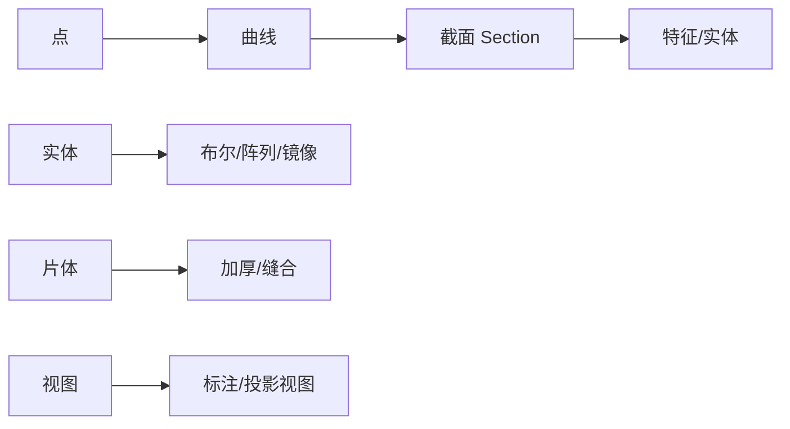
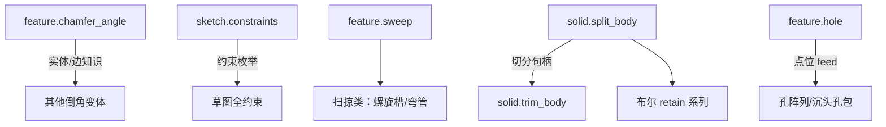

# 依赖分析与攻击顺序（DEPENDENCY）

> 说明：这份文档回答一个问题——**先攻哪个、后攻哪个，才不会白费一轮**。
> 生成时间 2026-10-21；能力数 139（L4 54）。

## 0. 结论先说

之前 60 轮的顺序**主要是按"成功率"排的，不是按依赖图排的**——这点要承认。
依赖关系只在局部用到（先有 `curve.helix` 才做 `feature.spring`；先摸清选择集三形态才敢碰 `solid.*`），但没有系统化。
下面把依赖显式化，并据此重排攻击顺序。

## 1. 输入基元与它们现在的生产者

| 输入基元 | 已真机验证的生产者 |
|---|---|
| 点 | curve.line 端点 / part.Points.CreatePoint |
| 曲线 | curve.line / curve.arc / curve.ellipse / curve.helix（GetEntities） |
| 面 | solid.block / solid.cylinder 的 GetFaces |
| 实体 | solid.block / solid.cylinder / solid.cone / solid.sphere |
| 片体 | surface.bounded_plane / feature.thicken（保留片体） |
| 基准轴 | part.Axes.CreateAxis |
| 基准面(Plane 对象) | part.Planes.CreateFixedPlane（注意：镜像/切分不认它） |
| 基准面(DatumPlane 特征) | part.Datums.CreateFixedDatumPlane（切分也不认） |
| 方向 | part.Directions.CreateDirection |
| 截面(Section) | CreateSectionsUsingCurves / Section.AddToSection(曲线种子) |
| 图纸 | drawing.sheet* |
| 视图 | drawing.base_view / drawing.view_isometric |
| 草图 | sketch.rect / sketch.extrude 等 |
| 表达式 | part.Expressions.Create / Expression.SetFormula |

**关键判断**：几何能力的依赖链其实只有三层——



所以**卡住的从来不是几何链**，而是"某个 builder 要一个我造不出来的句柄"（Plane/DatumPlane/FaceSetOffset/ReferencePointService）。

## 2. 待打通项的依赖分级

| 能力 | 需要什么 | 还缺哪个前置 | 级别 | 破法 |
|---|---|---|---|---|
| `feature.chamfer_angle` | 实体+边 | 无（chamfer builder 已通，只是角度模式没试） | **A** | 参数级：Option=OffsetAndAngle + AngleExp |
| `sketch.constraints` | 草图+几何 | 无（其余约束类型已通 12 种） | **A** | 枚举级：剩余约束类型逐个试 |
| `sketch.constant_length` | 草图+几何 | 无 | **A** | API 级：单参调用报错，可能要配合尺寸 |
| `feature.sweep` | 曲线(截面)+曲线(引导) | 有曲线，缺'可近似的引导' | **A** | 几何级：换更平滑的引导曲线或在 Tolerance 上做文章 |
| `feature.hole` | 实体+点位 | 缺'点作为 Section 输入' | **B** | 关键洞察：Section 吃曲线 → 试用极短线的端点当孔位 |
| `solid.split_body` | 实体+切分工具 | 缺'NX 认的 Plane 句柄' | **B** | 破法：借一个辅助体的平面面当工具体（镜像那招） |
| `solid.move_body` | 实体+运动参数 | 缺 ModlMotion 的提交配置 | **B** | 破法：先 Commit Motion 再 CommitFeature，或用 Transform 版 API |
| `pattern.body_linear` | 实体+参考点服务 | 缺 PatternReferencePointService 配置 | **B** | 破法：先用默认参考点直接 Commit，不碰该服务 |
| `solid.delete_body` | 实体 | 缺 BodyToDelete 选择初始化 | **B** | 破法：同 split（借 BooleanTool/Collector 的初始化顺序） |
| `drawing.dimension` | 图纸+视图+几何 | 缺标注上下文 | **C** | 要视图激活 + Annotation 创建器 |
| `drawing.projected_view` | 图纸+父视图 | 缺可写父视图 | **C** | ParentViewBuilder.View 只读 → 需要别的创建路径 |
| `drawing.section_view` | 图纸+剖切线 | 缺 SectionLine | **C** | 需先在视图里建剖切线 |
| `asm.constraints(解算)` | 装配+约束+求解器 | 缺可用的求解触发 | **C** | EstablishNetwork 会崩会话，只能换 API |
| `feature.rib` | 实体+轮廓 | 构建器不存在 | **D** | CreateRibBuilder 不在 FeatureCollection |
| `cam.setup` | CAM 模块 | builder 全 None | **D** | 需 CAM 许可与模块上下文 |
| `cae.mesh` | CAE 模块 | builder/集合不可用 | **D** | 需 CAE 许可与网格上下文 |
| `export.dxf` | 图纸 | 危险：Commit 死循环 | **X** | 永久禁用 |

分级含义：

- **A**：前置全都有，只差参数/枚举知识 → 成功率最高，先打。
- **B**：缺一个可合成的句柄，但有已知的"偏方" → 中等，值得试 2–3 次。
- **C**：缺交互上下文（NX 要在 UI 激活状态下才给的）→ 低，最后碰。
- **D/X**：模块缺失或危险接口 → 不再投入。

## 3. 重排后的攻击顺序

```
第 1 批（A 级，按依赖先后）
  1. feature.chamfer_angle   ← 实体+边都已就绪，只差 Option/AngleExp
  2. sketch.constraints(剩余) ← ✅ normal 已通；slope/constant_angle 判为不可用
  3. feature.sweep           ← ✅ 已通（G0/G1 容差是关键）
  4. sketch.constant_length  ← 单参报错，试配合尺寸

第 2 批（B 级，按'句柄合成难度'）
  5. solid.split_body        ← ✅ 已通（ToolFaces.FaceCollector.AddRules）
  6. feature.hole            ← 借极短线端点当孔位（Section 吃曲线）
  7. solid.move_body         ← Motion 的提交顺序
  8. pattern.body_linear     ← 绕开 ReferencePoint 服务
  9. solid.delete_body       ← 选择集初始化顺序

第 3 批（C 级）
 10. drawing.dimension / projected_view / section_view / asm 解算

不做：feature.rib / cam.setup / cae.mesh / export.dxf
```

## 4. 为什么第 1 批排在最前（依赖理由）

- `feature.chamfer_angle` 依赖的 `ChamferBuilder`+`ScCollector`+`FirstOffsetExp`
  已经在 `feature.chamfer` / `feature.chamfer_multi` 里验证过，**唯一未验证的是角度分支**；失败成本最低。
- `sketch.constraints` 已通 12 种约束，剩余类型同族同 API，只是枚举名字未知。
- `feature.sweep` 的 `SweptBuilder.SectionList/GuideList` 都能 Append（已试过），
  卡在"引导串无法近似"——这是**几何质量**问题，换一条圆弧引导比换 API 更可能成功。

## 5. 一张图看清"谁解锁谁"



## 6. 落地规则（写进 AGENTS.md 的那条）

每攻一条新能力前，先回答三个问题，答不上就不开工：

1. 它要的**输入基元**，现在有没有真机验证过的生产者？
2. 它要的**句柄/服务对象**，语法上能不能从已通的 API 合成？
3. 失败时**判据能不能区分"没生效"和"生效了但值不同"**？

三条全 yes → A 级，直接做；有一条 no → 先补前置或降级。

## 7. 2026-10-22 补充判据：builder 的"参数类型"决定它在 journal 里能不能用

| builder 参数形态 | journal 可用？ | 例子 |
|---|---|---|
| 几何 / 表达式 / 枚举 | ✅ | split（面）、sweep（G0/G1 容差）、chamfer_angle（枚举） |
| 内部服务对象 / 求值器 | ❌ | hole（公差三元组）、move_body（ModlMotion 不生效）、pattern_body（ReferencePoint 服务）、offset_surface（FaceSetOffset） |

**筛选规则**：动手前先看 builder 需要的是不是"能自己造出来的值"；需要服务对象就先找它的工厂方法，找不到直接判 C 级。

## 8. 基准特征能当输入吗？分三种情况

| 目标位置 | 接受 Datum 吗 | 证据 |
|---|---|---|
| 镜像/切分的平面 | ✅ 面的形式可以（`ToolFaces.FaceCollector`） | split/mirror 已通 |
| 旋转轴 | ❌ 只认 `NXOpen.Axis`（`DatumAxis` 被拒） | revolve 报类型错 |
| 拉伸起面 | 未测 | — |
| 投影目标面 | ✅ `part.Planes.CreateFixedPlane` 可以（DatumPlane 反而被拒） | curve.project 已通 |
